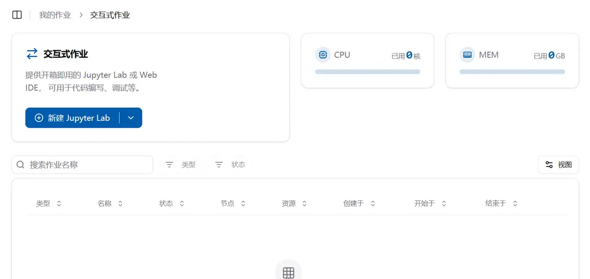
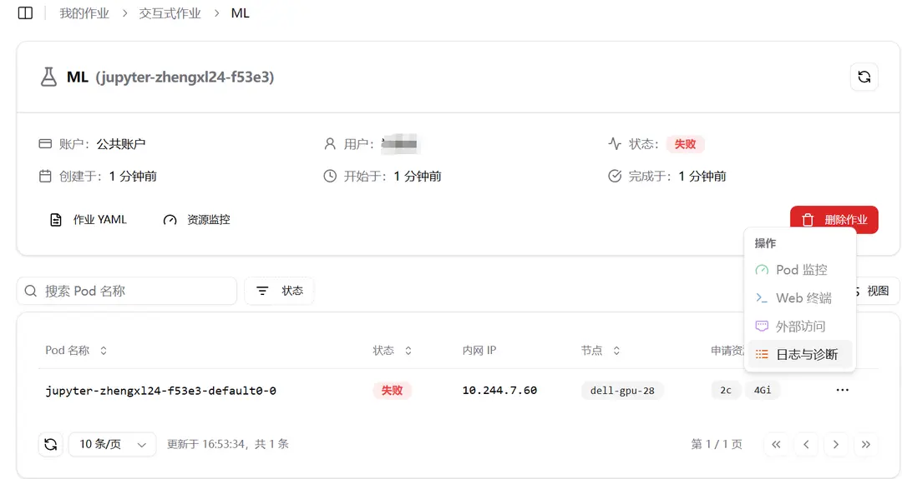

import { DynamicLink } from "fumadocs-core/dynamic-link";

## プラットフォーム概要

Craterは、The Crater Project Team, RAIDS-Labによって開発された、クラスター管理に特化したプラットフォームです。クラスター内のコンピューティングリソースやストレージリソースなどを一元的にスケジューリング・管理することで、クラスターの安定稼働とリソース利用の最適化を実現します。これにより、ユーザーはクラスターリソースを効率的かつ容易に管理できます。

### 直感的なインターフェース設計

Crater はシンプルで使いやすいユーザーインターフェースを提供しており、ユーザーはグラフィカルな操作インターフェースを通じて、さまざまなクラスタ管理タスクを簡単に実行できます。たとえば、リソースダッシュボードは、クラスタリソースの使用状況をリアルタイムで表示します。このダッシュボードでは、CPU 使用率、メモリ使用量、ストレージ容量などの指標が表示されます。

ジョブ管理インターフェースでは、実行中のジョブ、ジョブキュー、ジョブ履歴が表示され、ユーザーはいつでもタスクの状態を確認し、操作を行うことができます。

Volcano ジョブ一覧は入隊待ち、キュー待機中、起動中、作成済みなどの段階で絞り込めます。入隊待ちには旧方式の事前キュー待機ジョブと未入隊のジョブが含まれます。件数は権限、期間、検索、他の条件を満たす全ページの結果が対象です。段階を変更しても他の条件は保持されます。すべての段階の選択肢は常に表示され、件数が 0 でも選択できます。段階の絞り込みを解除しても、選択が解除されるだけで選択肢は非表示になりません。

### 高効率なリソーススケジューリング

プラットフォームは、ジョブの優先度、リソース要件などの要因に基づいて、スマートなリソーススケジューリングアルゴリズムを採用しており、ジョブに最適なリソースを自動的に割り当てます。たとえば、複数のジョブが同時にリソースを要求する場合、Crater は迅速に分析し、最も緊急で重要であるタスクにリソースを割り当て、全体の実行効率を向上させます。

### モニタリング機能

詳細なモニタリングデータとログ記録は、ユーザーにとってクラスタの運営状況を深く理解するための根拠を提供し、障害の特定と性能最適化が容易になります。

## 目次

本マニュアルは、クラスタユーザーがプラットフォームにアクセスする方法、インタラクティブジョブとバッチジョブの使用方法、データの提出、イメージの作成、VSCode 拡張機能へのアクセスなどについて学ぶのを助けることができます。

<Cards>
  <Card href="/jp/docs/user/quick-start/login" title="プラットフォームへのアクセス">
    ラボ内で Crater プラットフォームにアクセスする方法を学ぶ
  </Card>
  <Card href="/jp/docs/user/quick-start/interactive" title="インタラクティブジョブ">
    インタラクティブジョブの使用方法を学ぶ
  </Card>
  <Card href="/jp/docs/user/quick-start/batchprocess" title="カスタムジョブ">
    カスタムジョブの使用方法を学ぶ
  </Card>
  <Card href="/jp/docs/user/file/file" title="ファイルシステム">
    ファイルシステムの使用方法を学ぶ
  </Card>
  <Card href="/jp/docs/user/file/dataset" title="データセット">
    データセットの使用方法を学ぶ
  </Card>
  <Card href="/jp/docs/user/image/imageCreate" title="イメージ作成">
    イメージの作成方法を学ぶ
  </Card>
</Cards>

このマニュアルが、クラスタプラットフォームの機能を最大限に活用するお手伝いができることを願っています！
