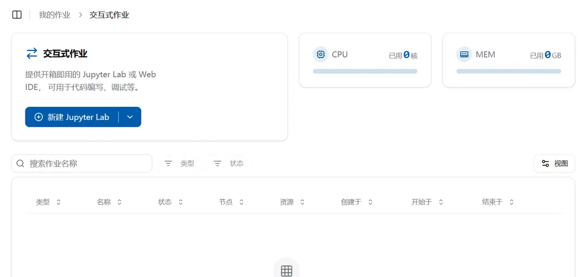
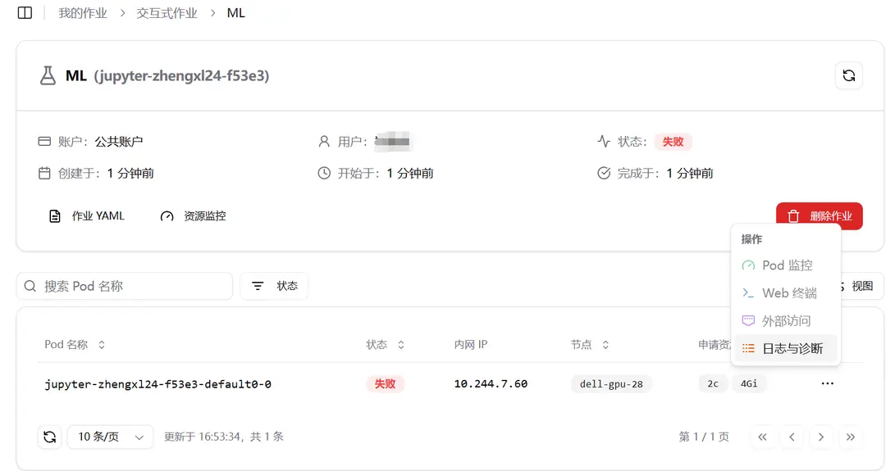

import { DynamicLink } from "fumadocs-core/dynamic-link";

## 平台简介

Crater 是一款由 The Crater Project Team, RAIDS-Lab 自主研发，专门用于集群管理的平台，为集群用户提供了高效、便捷的集群资源管理方案。它能够对集群中的计算资源、存储资源等进行统一的调度和管理，确保集群的稳定运行和资源的优化利用。

### 直观的界面设计

Crater 提供了简洁、易用的用户界面，用户可以通过图形化的操作界面轻松完成各种集群管理任务。例如，通过资源仪表盘能够实时展示集群资源的使用情况，包括 CPU 使用率、内存占用、存储容量等指标。

作业管理界面可以呈现正在运行的作业、作业队列以及作业历史记录，方便用户随时查看任务状态和进行操作。

### 高效的资源调度

平台采用智能的资源调度算法，根据作业的优先级、资源需求等因素，自动分配最优的资源给作业。例如，当有多个作业同时请求资源时，Crater 能够快速分析并将资源分配给最紧急、最关键的任务，提高整体执行效率。

### 监控功能

详细的监控数据和日志记录为用户提供了深入了解集群运行情况的依据，方便用户进行故障排查和性能优化。

## 浏览分页列表

### 按页查看模板、数据集、共享文件、模型和镜像

1. 打开对应列表，用搜索框和页面提供的筛选项缩小结果范围。分页查询会先搜索、筛选和排序，再返回当前页，而不是只搜索当前页的记录。
2. 使用列表底部的页码、上一页／下一页和每页数量控件浏览结果。总数表示当前筛选条件下你有权查看的记录数。
3. 模板、数据集、共享文件和模型页面修改搜索、所有者筛选、排序或每页数量后，会回到第一页。模板更新和删除操作仍受原有权限限制。

模型首页按组织聚合展示，进入组织后可查看其中的模型。模型页保留本地搜索、筛选和分页；首页的总数表示匹配的组织数。

账户成员表和数据集“共享用户”表也按页读取，支持按用户名搜索和排序。账户成员还可按角色、访问模式筛选。添加成员或共享用户时，选择器仍显示完整的待添加用户列表。

模板、数据集和共享文件列表读取失败时会保留请求页码，并提供“重试”入口。点击“重试”重新读取；不要把失败时缺少数据或总数当成成功查询到零条记录。删除后若原页已超出最新结果范围，成功重查后会回到最后一个有效页。

### 分批查看普通作业 Pod

普通 Volcano 作业详情中的“基本信息”页会分批读取 Pod 快照。“加载更多”追加下一批；快照成功读取且没有更多按钮时，表示当前快照已读完。搜索、筛选和排序只作用于已加载的 Pod。Pod 状态可能变化，点击“刷新快照”会重新开始读取。此列表不显示页码或数据库式总数。EMIAS 作业继续使用原有详情和 Pod 读取接口，本次不增加 EMIAS 快照分页接口。

管理员节点管理页也使用分批快照读取。文件目录、账户成员和数据集共享关系表不使用这种快照分页。

## 目录

本手册可帮助集群用户学习如何访问平台，使用交互式作业和批处理作业、提交数据、制作镜像以及 VSCode 扩展访问等功能

<Cards>
  <Card href="/zh/docs/user/quick-start/login" title="平台访问">
    了解如何在实验室内部访问 Crater 平台
  </Card>
  <Card href="/zh/docs/user/quick-start/interactive" title="交互式作业">
    了解如何使用交互式作业
  </Card>
  <Card href="/zh/docs/user/quick-start/batchprocess" title="自定义作业">
    了解如何使用自定义作业
  </Card>
  <Card href="/zh/docs/user/file/file" title="文件系统">
    了解如何使用文件系统
  </Card>
  <Card href="/zh/docs/user/file/dataset" title="数据集">
    了解如何使用数据集
  </Card>
  <Card href="/zh/docs/user/image/imageCreate" title="镜像制作">
    了解如何制作镜像
  </Card>
</Cards>

希望本手册能帮助你充分利用集群平台的功能！
