**인터랙티브 작업** 기능은 사용자에게 **즉시 사용 가능한 Jupyter Lab 및 Web IDE**를 제공하며, 본 문서는 인터랙티브 작업의 생성 및 관리 등 관련 내용을 설명합니다.

## 인터랙티브 작업 생성

**"플랫폼 개요"** 페이지 또는 **"내 작업" -> "인터랙티브 작업"** 페이지에서 **"새로운 Jupyter Lab"** 버튼을 클릭하여 Jupyter Lab 의 새 작업 페이지로 이동할 수 있습니다.

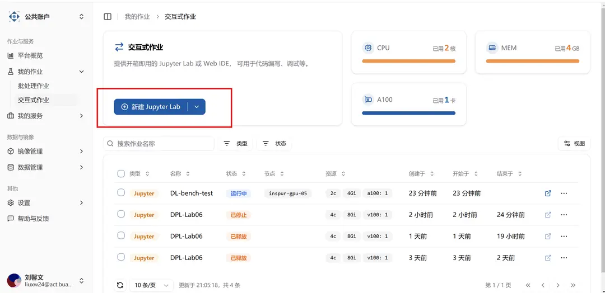

**"새로운 Jupyter Lab"** 페이지에서는 **인터랙티브 작업에 대한 다양한 설정**을 수행할 수 있습니다:

- 작업 이름
- 작업 자원 (예: CPU 코어 수, 메모리 사용량, GPU 사용 여부 및 사용할 GPU 모델 선택)
- 컨테이너 이미지
- 데이터 마운트 디렉토리 설정
- 환경 변수 추가
- 기타 옵션
  - 상태 알림 수신
  - CPU 핀 고정 활성화
  - 대상 노드 제어 (화이트리스트 / 블랙리스트 모드)

공유 스토리지가 필요하지 않은 작업은 모든 파일 디렉터리 및 데이터셋 마운트를 삭제한 후 제출할 수 있습니다. 스토리지 마운트가 없는 작업은 스토리지 할당량 검사를 건너뛰므로 개인 디렉터리가 가득 찼거나 할당량 조회가 실패해도 다른 생성 검사를 계속합니다. 마운트가 있는 작업은 할당량 또는 사용량 조회에 실패하면 생성이 중단되며, 나중에 다시 시도하거나 모든 마운트를 제거하라는 안내가 표시됩니다. 이것이 반드시 Ceph 클러스터 장애를 의미하는 것은 아닙니다. 마운트를 제거하기 전에 이미지, 시작 명령 및 작업 디렉터리가 해당 파일에 의존하지 않는지 확인하고, 출력물을 다른 방법으로 저장하도록 준비하세요. 컨테이너의 임시 파일은 공유 스토리지에 자동 저장되지 않습니다.

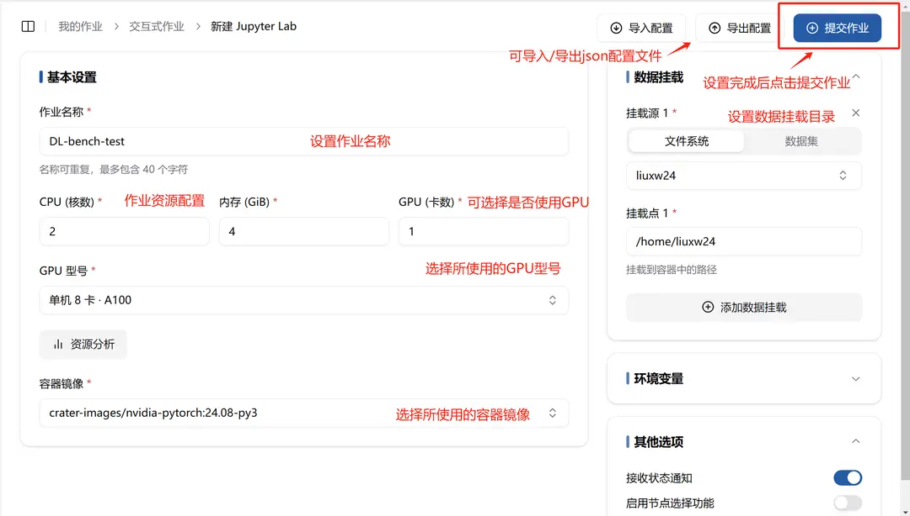

인터랙티브 작업의 다양한 설정은 **설정 파일을 가져오기**를 통해 수행할 수 있으며, 이미 설정된 작업은 **설정 파일을 내보내기**를 통해 설정 파일을 내보낼 수 있습니다. 예시는 다음과 같습니다:

```json
{
  "version": "20260922",
  "type": "jupyter",
  "data": {
    "jobName": "DL-bench-test",
    "task": {
      "taskName": "training",
      "replicas": 1,
      "resource": {
        "cpu": 2,
        "memory": 8,
        "gpu": {
          "count": 1,
          "model": "nvidia.com/a100"
        },
        "network": {
          "enabled": false
        },
        "vgpu": {
          "enabled": false
        }
      },
      "image": {
        "imageLink": "harbor.act.buaa.edu.cn/crater-images/nvidia-pytorch:24.08-py3",
        "archs": ["linux/amd64"]
      },
      "shell": "",
      "command": "",
      "workingDir": "/home/liuxw24",
      "ports": []
    },
    "volumeMounts": [
      {
        "type": 1,
        "subPath": "liuxw24",
        "mountPath": "/home/liuxw24"
      }
    ],
    "envs": [],
    "nodeSelector": {
      "enable": false,
      "mode": "include",
      "nodes": []
    },
    "alertEnabled": true,
    "cpuPinningEnabled": false,
    "forwards": []
  }
}
```

제출된 작업이 성공적으로 실행되었음을 확인할 수 있습니다.

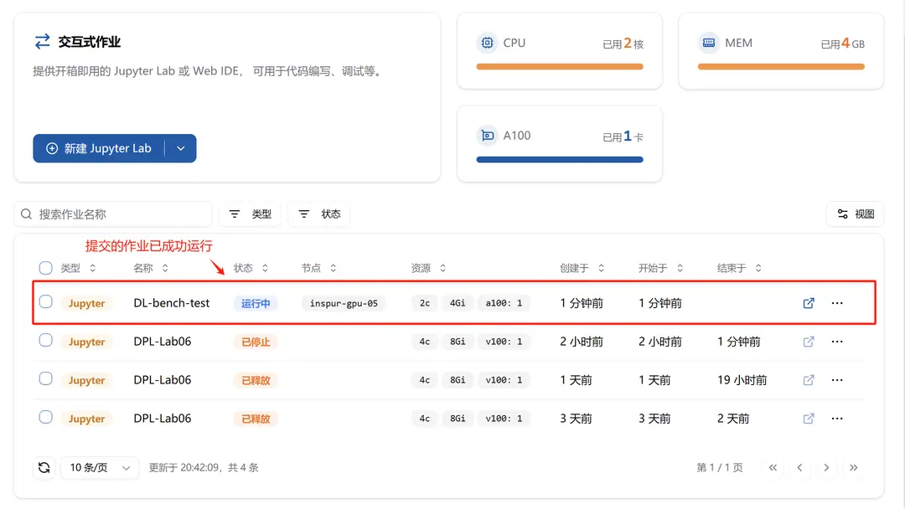

## 생성된 작업 관리

- 작업 이름을 클릭하면 작업 상세 페이지로 이동합니다.
- 상세 정보: 작업 상세 페이지로 이동
- 복제: 현재 작업 설정을 기반으로 작업을 복제할 수 있습니다 (사용자가 비슷한 설정으로 반복 제출하는 데 편리함)
- 중지: 현재 작업을 중지하고 사용 중인 자원을 해제합니다.

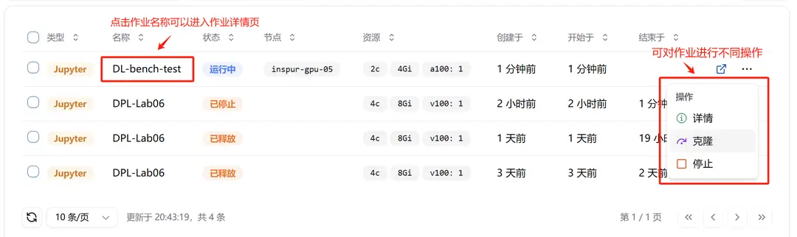

"복제"를 클릭하면 다음과 같은 페이지를 볼 수 있습니다:

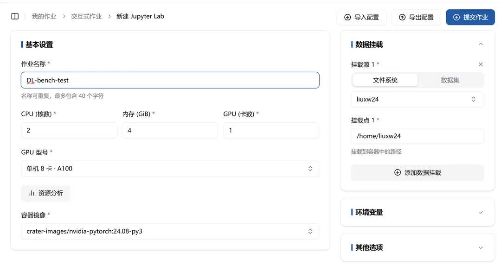

복제된 작업과 동일한 설정이 자동으로 생성되었음을 확인할 수 있습니다 (자동으로 입력됨). 사용자는 약간 수정 후 제출할 수 있습니다.

## 작업 상세 페이지

작업 상세 페이지는 작업이 속한 계정, 작업 생성자, 작업 상태, 생성 시간, 시작 시간, 완료 시간 등 기본 정보를 포함합니다.

또한 작업에 대한 모니터링 및 관리 방법도 제공합니다.

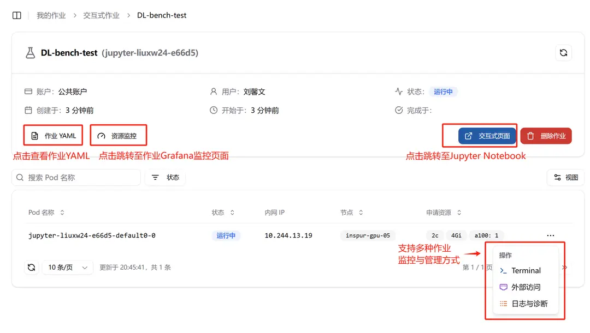

### 작업 YAML

- 작업 YAML: 작업 YAML 파일을 확인할 수 있습니다.

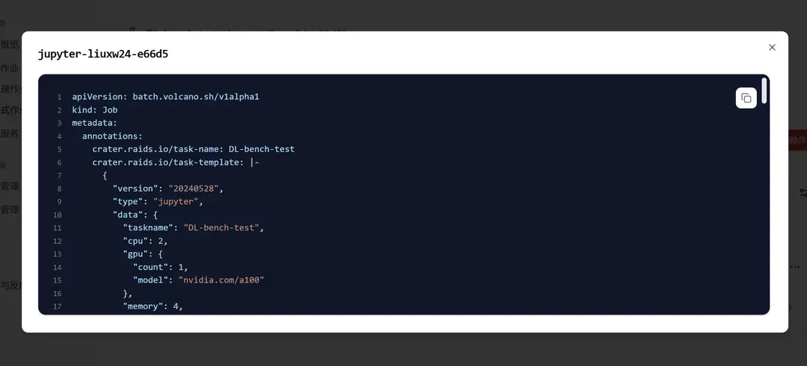

### 자원 모니터링

- 자원 모니터링: 작업의 Grafana 모니터링 페이지로 이동할 수 있습니다.

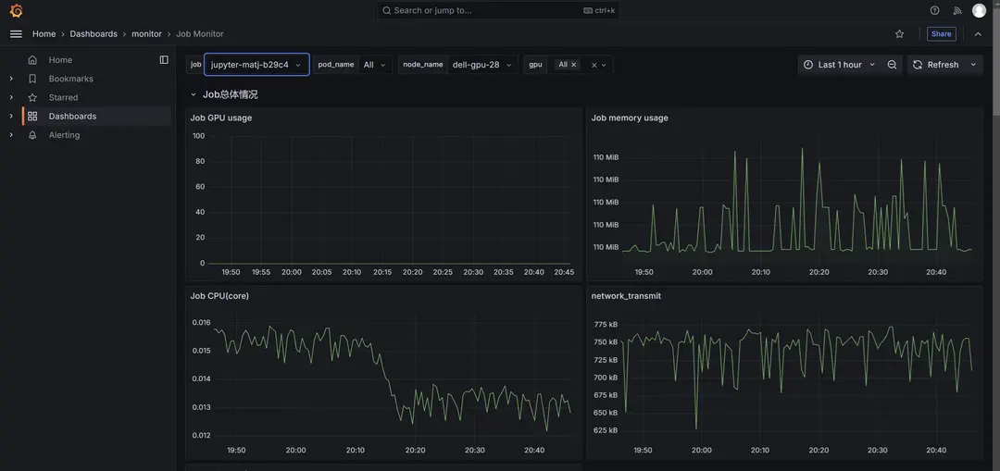

### 인터랙티브 페이지

- 인터랙티브 페이지: Jupyter Notebook 으로 이동할 수 있습니다.

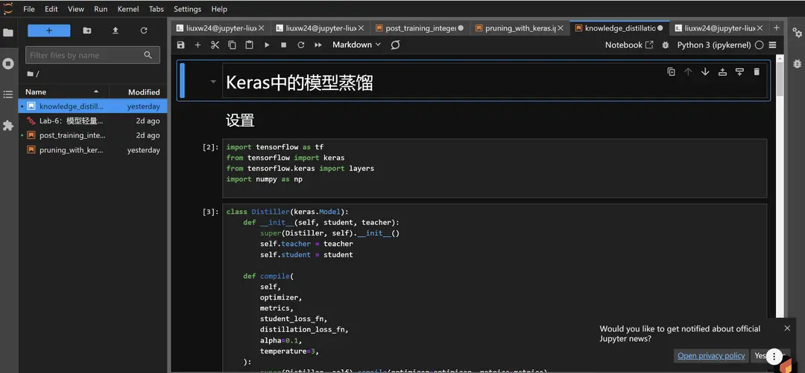

### 터미널

- 터미널: 작업의 Web 터미널에 접속할 수 있습니다.

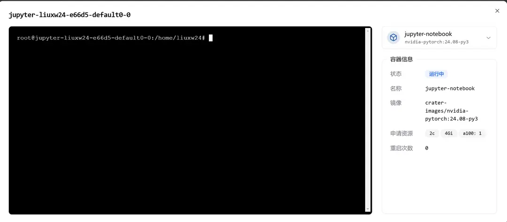

### 외부 접근

- 외부 접근: 작업에 대한 외부 접근 규칙을 설정할 수 있습니다. 자세한 내용은 [외부 접근 규칙 설정](../toolbox/external-access/ingress-rule.md)을 참조하십시오.

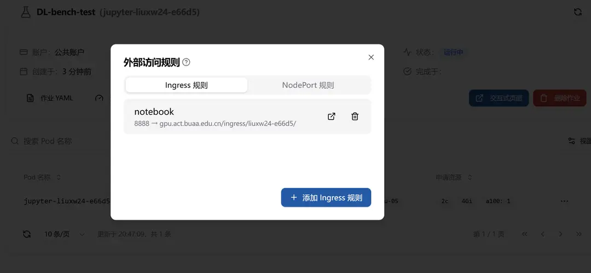

### 로그 및 진단

- 로그 및 진단: 작업 로그를 확인하여 문제 진단 및 분석이 가능합니다.

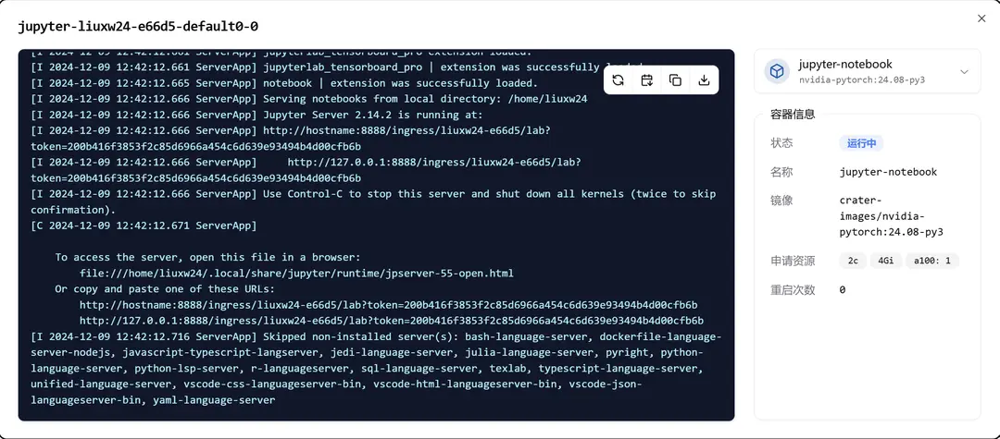
